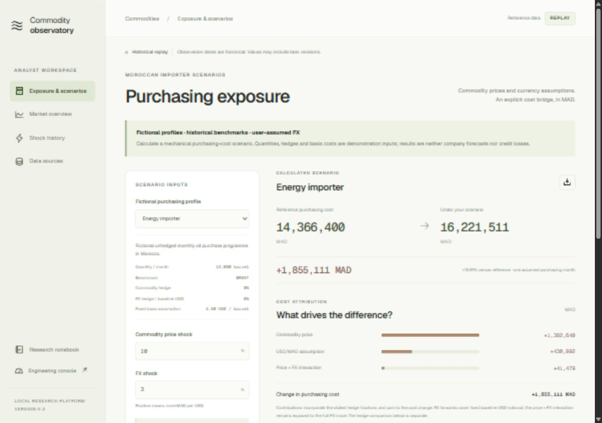

# Commodity Shock Observatory

**Which commodity moves change an importer's purchasing costs, and do they improve inflation forecasts?**

A local Kafka/Spark platform combining auditable commodity surveillance, fictional Moroccan importer exposures, mechanical cost scenarios and chronologically evaluated macro research. Daily analyst use and engineering evaluation have separate workspaces.



## What V2 adds

- **Exposure scenarios:** energy, copper and wheat purchasing profiles, explicit quantities, basis assumptions and hedges. MAD/USD is a user assumption, never an invented market quote. Price, FX and interaction effects reconcile to the net cost change.
- **Incremental Spark features:** PostgreSQL COPY ingestion, typed Delta Silver, indexed affected neighborhoods and executor-side exact rolling median/MAD calculations. Canonical OHLC uses unique economic observations; delivery counters remain operational telemetry.
- **Correction-safe serving:** historical revisions trigger only affected calculations. Session leases, generation-fenced UPSERTs and durable dirty events support recovery across partial commits. V1 tables/checkpoints remain separate.
- **Independent event clocks:** REPLAY, LIVE and SYNTHETIC window queries have separate sources/checkpoints. A new synthetic timestamp cannot evict replay state.
- **Stronger evidence:** matched calibration alert budgets with disjoint seeds, full-history feature parity, forced recovery at a partial-commit boundary, burst and sustained workload measurements.
- **Macro V2:** latest-known revisions at each forecast origin, first-release target semantics, coverage diagnostics, paired block-bootstrap loss intervals and past-only residual prediction bands.

## Evidence before interpretation

The public reference history contains **13,796 real daily/monthly observations** across Brent, WTI, gold, copper and wheat. Synthetic engineering traffic is isolated and is not counted as additional market coverage.

Spark matches an independent pandas oracle, including negative oil prices, exact even-window medians, monthly windows and microsecond precision. A 30,050-row synthetic database fixture with two distant corrections requires only 126 feature-context rows; a dense batch of 2,000 changes requires 2,124.

The real-data macro experiment remains **exploratory revised-data analysis**. At 96 evaluation origins per horizon:

| Model | MAE, 1 month / pp | MAE, 3 months / pp |
| --- | ---: | ---: |
| Persistence | 0.551 | 0.859 |
| AR + oil ridge | 0.556 | 0.925 |
| XGBoost | 0.871 | 1.198 |

Oil-ridge's paired loss-difference intervals include zero. More complex models do not improve on persistence in this specification. Nominal 90% prediction bands under-cover in this sample; their empirical coverage is reported rather than treated as a guarantee.

The V2 detector study calibrates methods at the same 1% clean-history alert budget, then evaluates held-out regimes and rare inserted jumps. Precision is low despite useful recall. Historical crisis cases are contextual review examples, not independent shock labels. The synthetic comparison does not silently replace the operational screening rule.

See [V2 local evidence](docs/LOCAL_VALIDATION_V2.md), [macro protocol](docs/MACRO_V2.md), [detector protocol](docs/DETECTORS_V2.md) and the [archived V1 result](docs/LOCAL_VALIDATION.md).

## Run locally

Requires Python 3.11/3.12, uv, Node 22+ and Docker Desktop with Linux containers and approximately 6 GB free RAM.

```powershell
uv sync --frozen
cd frontend
npm ci
npm run build
cd ..
docker compose up -d --build
uv run cso init
uv run cso fetch --start 2000-01-01
uv run cso replay
```

Open http://127.0.0.1:8080. Engineering console: http://127.0.0.1:8080/ops. After a V1 upgrade, new V2 checkpoints consume retained Kafka data; replay the complete archive if Kafka retention has expired. Keep checkpoints and completion metadata together.

```powershell
uv run pytest -q
docker compose run --rm --no-deps spark python -m observatory.v2_checks
uv run cso verify
uv run cso reliability
uv run cso commit-recovery
uv run cso load-test --events 5000
uv run cso sustained-load --seconds 120 --rate 50
uv run cso evaluate-detectors
uv run cso macro --origins 96
```

`reliability` and `commit-recovery` deliberately interrupt only this project's Spark service. Do not run recovery/load exercises concurrently. The default unit suite skips opt-in PostgreSQL cases; run them using `CSO_DB_TESTS=1` against the local PostgreSQL service. They use a disposable private schema.

The first `macro` run downloads the public revised panel. To rerun offline after that, use `uv run cso macro --panel data/macro-revised.csv --origins 96`; this ignored data file is not included in the repository.

## Understand the implementation

- [Step-by-step V2 guide in French](docs/V2_GUIDE_FR.md)
- [Exposure assumptions and endpoints](docs/EXPOSURE_V2.md)
- [V2 architecture and recovery boundaries](docs/ARCHITECTURE_V2.md)
- [Initial learning guide / V1](docs/GUIDE_FR.md)

## Data and deployment boundaries

Public oil histories are daily EIA spot prices via FRED; World Bank benchmarks are monthly. Replaying faster creates no intraday information. Original publication times are unknown in these revised snapshots; manifests preserve source URLs, acquisition time and SHA256.

Strict ALFRED evaluation requires a personal FRED API key. Generic imported CSV cannot be promoted to strict evidence with a flag. The metadata-gated API path still needs archival coverage review and an exercised real-account run. The optional Twelve Data adapter requires your entitled account; it uses a persistent bounded publisher but has not been tested with a licensed live feed here.

The reference deployment is single broker / Spark local[2]. The Python ingestion/context bridge remains bounded, and long backfills or very high-rate instruments need a separately benchmarked deployment. Burst and sustained tests are local measurements; V1 and V2 latency protocols differ. No cluster-capacity, banking production SLA, causal inflation or trading-profit claim.

Services bind to localhost. Production requires authentication, network and secret controls, licence review, backups and high availability. Raw data, credentials, runtime lake/checkpoints and detailed generated forecasts are ignored by Git. Aggregate evidence and screenshots are included. Third-party data retain their own terms; code is MIT.
