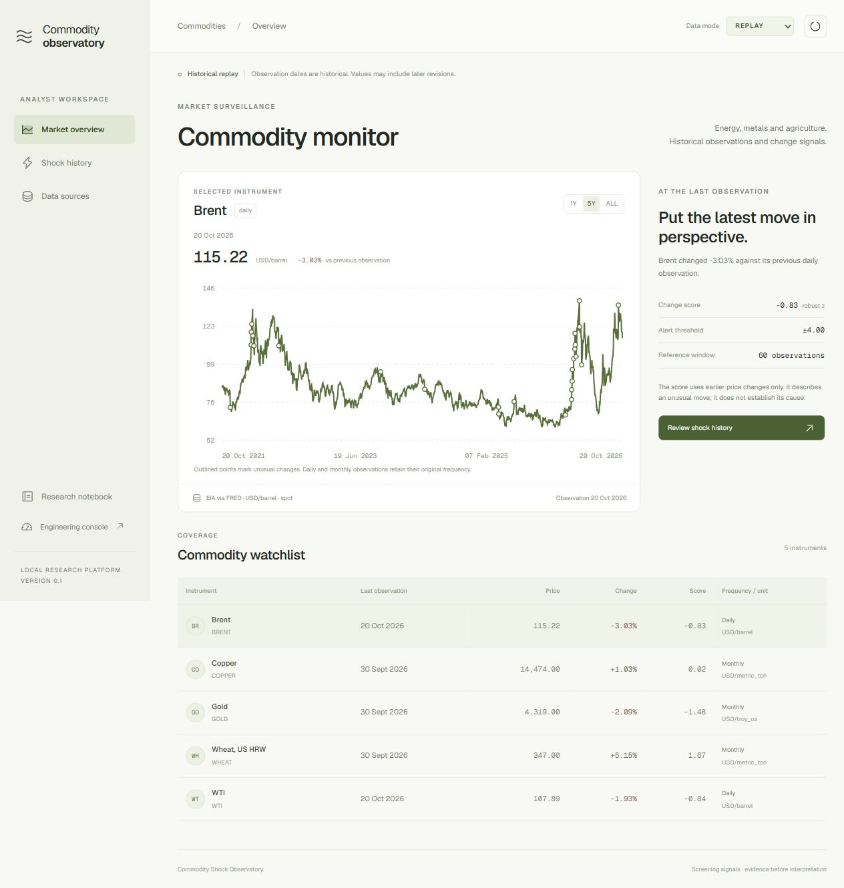

# Commodity Shock Observatory

**Which commodity moves deserve an analyst's attention, and does oil improve inflation forecasts?**

A local event-driven research platform: public commodity histories flow through **Kafka**, **Spark Structured Streaming**, **Delta Lake** and **PostgreSQL** into an analyst workspace. Macroeconomic experiments and engineering evidence are separate from daily surveillance.

**Status:** locally validated Kafka/Spark implementation with an analyst UI, recovery exercises and measured synthetic load. Live market access requires your own entitled provider account. No production SLA or profitable trading claim. See [measured evidence and economic findings](docs/LOCAL_VALIDATION.md).



## Run

Requires Docker Desktop with Linux containers (about 6 GB free RAM), Python 3.11, Node 22+ and uv.

```powershell
uv sync --frozen
cd frontend
npm ci
npm run build
cd ..
docker compose up -d --build
uv run cso init
uv run cso fetch --start 2000-01-01
uv run cso replay
```

Open http://127.0.0.1:8080. The engineering console is http://127.0.0.1:8080/ops.

```powershell
uv run cso evaluate-detectors
uv run cso macro
uv run cso verify
uv run cso reliability
uv run cso load-test --events 5000
uv run pytest
```

Set `UV_CACHE_DIR` to a writable location if your environment restricts the default cache. The project's local `.venv` Python can be used directly instead of `uv run` after installation.

## Evidence and economic interpretation

REPLAY, LIVE and SYNTHETIC have isolated topics and observation keys. Brent / WTI histories are daily EIA spot prices via FRED. World Bank gold, copper and wheat benchmarks are monthly. Replaying them faster does not create intraday information. Download manifests preserve source URL, SHA256 and acquisition time. Original historical publication times are unknown in these snapshots.

The robust detector compares the current absolute price change with earlier changes only. Signed percentage changes use the absolute previous price; no log-return formula is applied to zero or negative oil prices. Monthly benchmarks use a separate 36-observation window. Alerts are screening signals, not causal explanations or labelled economic shocks.

The macro experiment compares persistence, autoregressive ridge, oil-augmented ridge and XGBoost on the same expanding-window origins. The default experiment is **exploratory revised-data analysis**, with explicit assumed availability lags. It retains revision leakage and cannot establish real-time predictive performance. `cso macro --strict` requires `FRED_API_KEY` and uses ALFRED initial releases, conservative next-day vintage availability, and initial-release inflation targets. No result is silently upgraded to strict evidence.

See [architecture and boundaries](docs/ARCHITECTURE.md), [step-by-step French guide](docs/GUIDE_FR.md), and [evaluation protocol](docs/EVALUATION.md).

## Stack and scope

Kafka 3.9.1 in KRaft mode; Spark 3.5.7 / Delta 3.3.2; Python / pandas / scikit-learn / XGBoost; PostgreSQL 17; FastAPI; React / TypeScript / Tailwind. Exact Python and frontend resolutions are locked. Optional Prometheus: `docker compose --profile monitoring up -d`.

Kafka/Spark are excessive for a few daily prices. This project uses that small economic dataset to make event contracts, replay, late data and recovery inspectable, and separately measures synthetic engineering load. The local single-node benchmark is not evidence of cluster scalability. Signals currently rebuild a bounded pandas serving snapshot; see the architecture's scale limit.

## Data and code rights

Raw downloads, local lake, checkpoints, keys and generated reports are ignored by Git. Source-specific terms still apply; this repository does not grant redistribution rights to third-party data. The Twelve Data adapter is disabled without a key and explicit licence acknowledgement. Review your provider's rights before sharing captures.

Code: MIT. Data: respective source terms.
