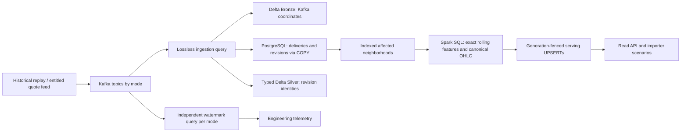

# V2 architecture and recovery boundaries

## State and data contracts

Existing V1 observation contracts and Kafka topics are retained. Delivery identity is `(topic,partition,offset)`; economic revision identity is `(mode,event_id)`. Typed Silver keeps revision events, and the serving snapshot chooses the last observed revision at each economic timestamp. Identity conflicts are quarantined. Existing canonical values take precedence over contradictory duplicates in the same batch.

The raw bridge carries at most 2,000 Kafka offsets per trigger. COPY, set-wise validation and inserts replace per-event round trips. A single ingestion query coordinates materialization. PostgreSQL and Delta are not one distributed transaction; retries repair intermediate states.

## Incremental context and distributed computation

Changed timestamps are durable before feature materialization. Dense changes use a bounded range probe and one predecessor/middle/successor read. Sparse changes use indexed neighborhoods of at most 62 preceding observations, one anchor and 62 following observations. Overlapping neighborhoods are merged and deduplicated. The first differencing step plus a 60-change history fits inside this margin. Non-emitted prefix rows provide context and never overwrite older serving rows with incomplete warm-up estimates.

Spark computes exact order-statistic medians and MAD, not approximate percentile substitutes. Each partition upserts only affected rows. Canonical bars use latest revisions, deterministic first/last ordering and explicit units/frequencies. They do not count Kafka re-deliveries or represent traded volume. A changed quote also rebuilds its affected bar bucket. SQL row limits precede fetching; requests exceeding the local bounds fail visibly rather than silently truncating data.

## Fencing and partial commits

`materialization_lease()` holds a session advisory lock across the complete raw batch callback. Its key differs from the ingestion transaction's advisory lock. A durable generation increments before materialization. Signal and bar UPSERTs reject older generations; batch completion also checks the current epoch. This prevents an obsolete task from replacing a newer correction after driver recovery.

Completed batch IDs belong to their durable checkpoint namespace. Never reset a checkpoint while retaining its completion ledger, and never share one checkpoint between drivers. V2 paths use `checkpoints/v2`, `lake/v2`, `signals_v2` and `market_bars_v2`. Per-mode window queries/checkpoints write to one `delivery_windows_v2` table keyed by mode; V1 tables and evidence are preserved.

Serving is eventually consistent across partitions and across signals/bars. It is not a globally atomic analyst snapshot. The completion ledger indicates progress, but newer in-place UPSERTs can already be partially visible; consulting it alone does not establish an atomic snapshot. Such a consumer would need a versioned publication barrier or another snapshot design. A bounded failure-injection option, disabled by default, validates recovery after observations are committed but before Silver/features/checkpoint completion. Synthetic traffic is isolated from economic reference data.

## Event-time clocks

REPLAY, LIVE and SYNTHETIC each have independent streaming window queries and checkpoints. Their seven-day watermarks cannot influence one another. Within a mode, instruments can still have different event-time progress: these windows are delivery telemetry, not canonical market bars. The raw path never discards late records, and canonical bars/scores use correction-aware indexed reconstruction. A production feed with heterogeneous lateness needs instrument-specific policies.

## Evidence scope

The Spark oracle exercises actual SQL computations and independent file-stream clocks. PostgreSQL integration tests use their own temporary schema and verify conflict precedence, generation fencing, migrations and bounded contexts. Kafka exercises verify actual driver restart, late/revised events and a deliberate partial commit. Sustained benchmarks poll serving concurrently with publication and report the achieved workload, lag, state memory and backlog drain. Latency and drain concern visibility in `signals_v2`, without necessarily waiting for OHLC writes or full callback completion. Unavailable telemetry is null, not zero.

This is a single-broker, local[2] deployment. It does not establish broker availability, multi-node throughput or an external feed SLA. The Python bridge is bounded, while very large backfills and extreme-rate bar buckets still require a separately designed and measured workload.
